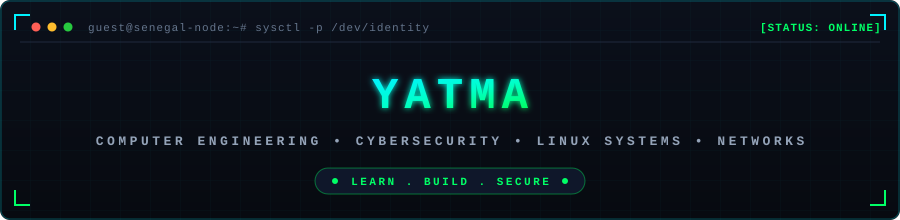

<div align="center">



# `> yatma.init()`
### Computer Engineering Student • Cybersecurity, Networks & Linux • Software Engineering

[](https://github.com/thiamyatma)
[](https://github.com/thiamyatma)
[](https://github.com/thiamyatma)
[](https://github.com/thiamyatma)

</div>

---

### `$ whoami`

```shell
[identity]   : Yatma (@thiamyatma)
[education]  : Computer Engineering Student — Sénégal
[focus]      : Defensive Cybersecurity • Linux Systems • Network Architectures • Software Engineering
[languages]  : French (Native / Fluent) | English (Technical Working Proficiency)
[status]     : Building, learning, and securing systems
